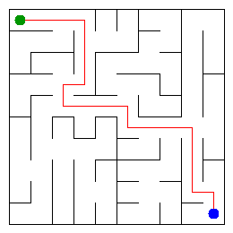

# Assignment 3 - Maze Escape

Student ID: 254735  
Name: Akberdiyeva Zhibek  
Group: SE-2511  
Maze size: 10 x 10

## Program output

```text
Broken: 99
Kept: 81
Last broken wall: 140
MST cost: 30238
Heaviest broken wall: 758
Path length: 20
DFS visited: 54
Dead ends: 29
Zones: 9
Largest zone: 19
Is DAG: 0
Flow stages: 6
Fastest route cost: 19
```

My maze:



## Questions

**Mission 0. What do find and union do, and what makes them fast in your code?**

The find method finds the group of an element. The union method joins two groups together. I used path compression and union by size to make these operations faster.

**Mission 1. Why is Broken always R*C - 1, and Kept always (R-1)*(C-1)?**

There are R*C cells in the maze. We need R*C - 1 broken walls to connect all cells without cycles. The other walls stay, so Kept is (R-1)*(C-1).

**Mission 2. My MST cost from Kruskal and from Prim, and why they are equal:**

My MST cost is 30238. Kruskal and Prim give the same cost because both algorithms find the cheapest way to connect all cells. They just work differently.

**Mission 3. Why is there exactly one path between two cells? How did you avoid a stack overflow on a huge maze?**

There is only one path because the maze is connected and has no cycles. I used a stack for DFS instead of recursion, so it can work with a large maze without stack overflow.

**Mission 4. Why does the second pass of Kosaraju go on the reversed graph? Why do the slides have no cycle exactly when Zones equals the number of cells?**

The reversed graph helps Kosaraju find the strongly connected components. If there are no cycles, every cell is its own zone, so the number of zones equals the number of cells.

**Mission 5. Why is it enough to go through the zones in the order of their numbers? What does this pass cost?**

The zones are in topological order, so we can process them one by one. We calculate the longest chain and the cheapest route during this process. My implementation uses O(Z² + M) time and O(Z²) extra space for this part.

## AI use

I used ChatGPT to understand the assignment, explain algorithms, find possible errors and help with the code and README. I also ran the program and tests to check the results.

## Timing (Mission 7)

| Maze | Kruskal average (ms) | Prim average (ms) |
|---|---:|---:|
| 100 x 100 | 45 | 23 |
| 300 x 300 | 215 | 152 |
| 1000 x 1000 | 3180 | 3771 |

The time increases when the maze gets bigger. Prim was faster for the first two sizes, but Kruskal was faster for the biggest maze. The results can be different on another computer.

## Complexity

| Algorithm | Time | Space | Assumptions |
|---|---|---|---|
| DSU find and union | O(α(n)) amortized | O(n) | Path compression and union by size |
| Kruskal | O(M log M) | O(n + M) | Sorting the walls |
| Prim | O((n + M) log M) | O(n + M) | Priority queue |
| DFS | O(n + M) | O(n + M) | Adjacency lists and stack |
| Kosaraju | O(n + M) | O(n + M) | Two DFS passes |
| Route in the zone graph | O(Z² + M) | O(Z²) | Topological order and cost matrix |

## Before you submit

- [ ] walls.txt and slides.txt are in the data folder.
- [ ] maze.png is in the output folder.
- [ ] All examples pass with java tools/Check.java.
- [ ] README is complete.
- [ ] All changes are pushed to main.
- [ ] The repository is public.
- [ ] The GitHub link is submitted in Moodle.
